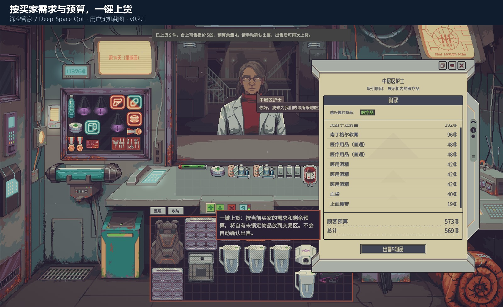
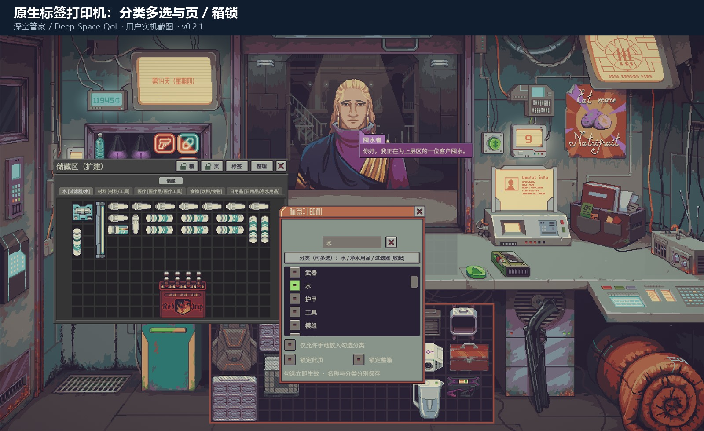
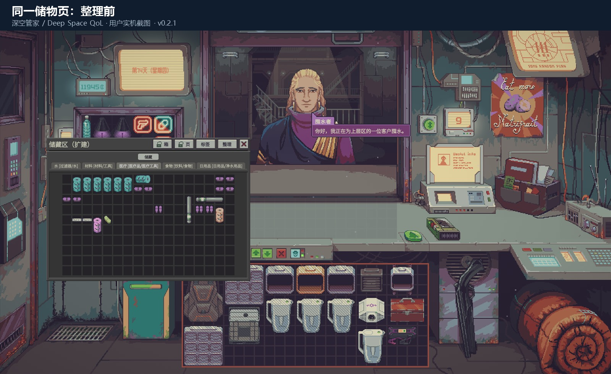
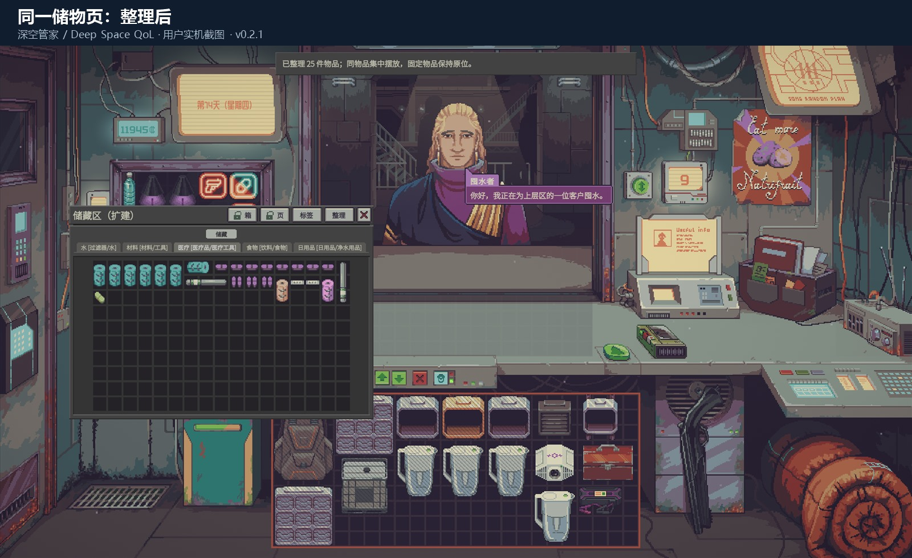
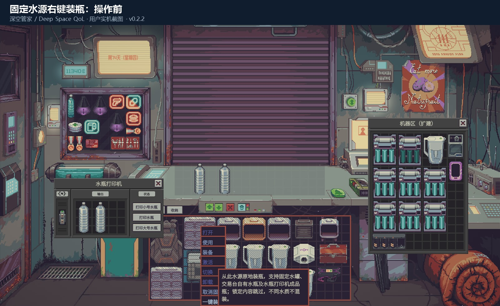
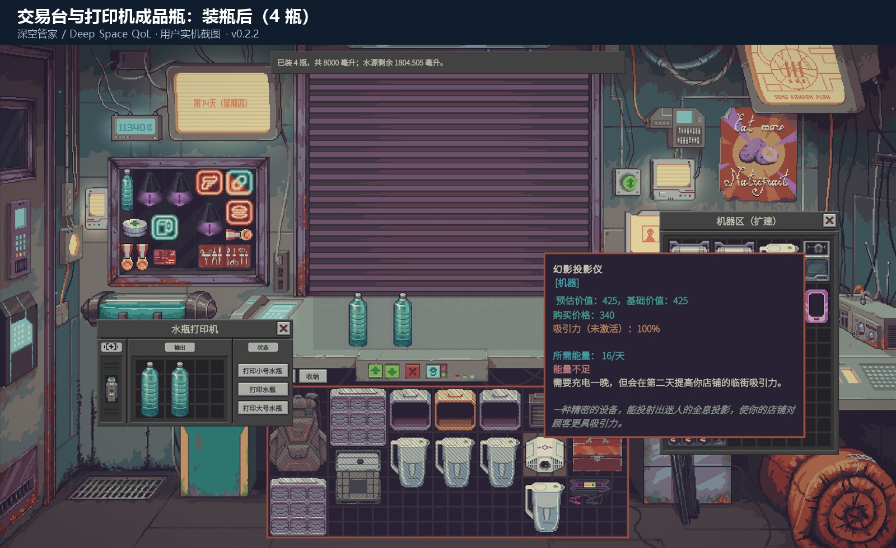

# 深空管家 / Deep Space QoL

《深空当铺 / Probably Stolen》官方 Mod API 模组，当前版本 **0.2.3**。提供原生窗口按钮、标签打印机分类勾选、按买家预算上货、分类收纳整理与水源右键装瓶。

[Steam 创意工坊订阅](https://steamcommunity.com/sharedfiles/filedetails/?id=3836735823) · [GitHub 测试版下载](https://github.com/Mangataaa/deep-space-qol/releases/tag/v0.2.3) · [问题反馈](https://github.com/Mangataaa/deep-space-qol/issues)

适配目标是开发时本机安装的 0.46 系列游戏程序集。已进行真实程序集编译、核心算法及原生规则回归测试、原生模组扫描。用户提供了上货、分类及整理截图，并在 **0.2.2 实机复测确认交易台与机器舱内打印机的四只空瓶均完成装水**；完整存档往返及其他模组兼容性尚未全面验证。

## 安装与开始使用

手动安装位置（也可使用 GitHub Releases 的成品 ZIP）：

```text
<游戏安装目录>\Mods\deep_space_qol
```

1. 关闭游戏。下载 Releases 中的 `DeepSpaceQoL-0.2.3.zip` 并解压，把其中的 `deep_space_qol` 成品目录放入游戏 `Mods` 文件夹；也可使用本项目脚本从源码构建并安装。
2. 启动游戏，在游戏的模组管理菜单启用“深空管家 / Deep Space QoL”，按游戏提示重启。
3. 载入存档进入店铺：绿色转移按钮左边的 **向上箭头** 上货；主库存工具条 **收纳**；储物窗口 **整理 / 标签 / 页锁 / 箱锁**；水源 **鼠标右键 → 一键装瓶**。
4. 储物窗口点“标签”或原生页签改名入口，打开标签打印机，直接勾选多个游戏分类。无需 F6。
5. **F6** 保留为高级设置与备用操作入口。游戏设置的“深空管家”分组中可更换快捷键，一键上货和一键收纳快捷键默认不绑定。

无需安装 BepInEx。成品只有自己的 DLL、官方清单、说明、许可证及构建校验文件。安装脚本不修改游戏程序集，不修改模组启用列表，也不操作存档。

使用工坊版时请先退出游戏，将同 ID 的手动安装副本移出 `Mods` 并保留备份，避免本地版本遮蔽工坊更新。现有本地安装不会被发布工具自动迁移或启用订阅。

首次使用请在可重新载入的存档中完成下方验收。出现异常时，按面板提示停止操作并保留游戏日志；若提示恢复失败，不要继续保存。

## 一键上货

买家到店后，点击绿色“转移所有物品”按钮左边新增的向上箭头。模组读取该买家的原生商品需求、报价和实际剩余预算，先扣除交易称重区已摆放且买家接受的自有商品价值，再寻找可放入的商品组合，优先提高本轮总报价并尽量贴近预算。操作结果会以不阻挡点击的屏幕提示显示。

如果称重区放不下，就先确认出售本轮商品，再次点击上货。**模组只负责备货，最终出售由你操作**。反复点击尚未成交的同一批商品不会重复计算预算。柜台满、预算不足、库存不足或没有合适商品时会给出提示。

- 读取主库存、前柜台与后工作台的自有商品，以及这些位置中的储物容器；隐藏区和展示柜只读取其中的储物容器，不动散放展示品。
- 跳过锁定内容、固定物品、非自有物品、需要先鉴定的物品、设备、储物箱本体、储水箱和带有内部物品的容器。
- **0.2.3 剧情保护：** 卢的玩具箱、缴款箱及其全部嵌套内容永远不作为自动上货/收纳来源或目标，不依赖手动锁箱。已离开箱子的卢玩具和原生重要物品也跳过。台面已有剧情物品时停止继续上货并提示收回，不计入自动预算。
- 遵守买家的品类、多样性要求和原生交易锁。放上台后重新检查价格，报价不再合适时尝试退回原处。
- 不感兴趣、排除分类/物品、已向当前多样性买家卖过的品种，既不自动上货，也不计入本模组的台上可售报价。多样性按游戏原生物品 ID 区分，不是按“食物/工具”等大类区分；同轮不重复摆同 ID，已在台上的品种会预留。若手动摆了重复品种，会先提示整理台面，避免把只能卖一次的品种重复计入。
- 治安部顾客额外使用放置前硬性检查：跳过 `CONTRABAND_ITEM_TAG`、`CONTRABAND`、`STOLEN_TAG` 商品及含有这些物品的容器，无论赃物热度、查获概率、隐藏状态或原生购买覆盖规则如何。安全商品仍必须符合顾客兴趣。若称重区已有自有违禁品/赃物，会停止继续上货并提示手动收回；不自动搬走，也不改变原版治安检查。
- 组合与摆放采用有限搜索，**不承诺数学上的全局最优**；大量库存下可能分多轮处理。
- 按完整物品/完整堆叠移动，不拆分堆叠。当一整堆超预算时不会自动拆出其中几件。

## 储物柜、箱子与页签规则

打开储物柜、箱子或背包，选中目标页，点窗口工具条的 **标签**，或使用原生页签改名入口。分类控件添加在原来的 **标签打印机** 中。

1. 原来的名称输入框继续用于改名。
2. 在下面的分类列表直接勾选 **食物 / 水 / 日用品** 等类别，支持多选和滚动。点击“分类（可多选）”可折叠或展开。选项来自游戏的 `TypeHelper` 分类列表及本地化名称，保存为真实类别 `tag:FOOD`、`tag:WATER` 等。
3. 勾选 **仅允许手动放入勾选分类** 时，任一类别匹配即可。
4. 可直接点击储物窗口的 **页锁 / 箱锁** 按钮，锁图标和页签 `[锁]` 标记即时更新；打印机也提供锁定勾选。
5. 勾选立即生效，然后按游戏正常方式保存存档。

**显示名称与分类是两个独立字段。** 只改名称不会产生分类约束；分类为空表示通用收纳页。可给同一页指定多个分类，任一匹配即可。

原生列表包括主类别及细分类型，常用主类别优先显示。旧版中文分类自动映射为等价标签，不改变原来匹配含义；精确 ID、自定义标签及其他高级条件保留显示，不会因打开新界面而被清空。F6 中仍保留高级表达式编辑，支持 `tag:FOOD`、`id:water_tank`、`*` / `全部`。所有条件按真实类别/标签或精确物品 ID 匹配，不做名称模糊匹配。

手动分类限制覆盖拖拽、多选拖拽、快捷转移及手动卸出。剧情强制放置、博士购物溢出、新生成物品和读档恢复继续走原生路径。已有的错类商品不会在保存规则时被强制弹出。

**0.2.1 起锁定表示跳过自动操作：自动收纳不放入、不取出，也不自动整理；一键上货和装瓶同样跳过锁定内容。** 锁定整个容器保护其所有页签，外层锁也保护嵌套箱子内容。仍允许手动取放和明确点击当前页的整理按钮，手动放入继续遵守分类约束。原生封锁容器则仍需按游戏要求解锁。规则保存在容器自己的原生存档状态中，停用模组后数据保留。

## 一键收纳整理

点击主库存窗口的 **收纳**，物品先尝试进入匹配分类的储物页；匹配页不可用时，尝试未设置分类的通用储物页。没有可放入的位置就留在原处，不塞入其他分类页。

**0.2.0 修复机器区误收纳：** 原版机器舱同样带 `STORAGE / CONTAINER_TAG`，现改为只接受经核对的真实储物柜、箱子、背包及其普通储物页。机器区、机器输入输出、装备/附件槽、功能容器均不作为收纳目标；机器和容器本体不被自动整理搬走。原生封锁的补给箱等也会跳过，不能绕过游戏的开锁要求。已经误放入机器区的商品需手动取回，本模组不会擅自清空机器内部。

**0.2.1 修复带包装的消耗品不收纳：** 水质检测试剂盒、净水药片等经核对的便携包装可以整件按分类收纳，内部物品不被拆出，包装内部也不会成为通用收纳目标。设备、柜子、功能槽继续排除；含有受保护内部内容的包装跳过。未移动原因会区分固定、锁定、设备/箱体、非自有或原生不可移除，避免仅显示“0件”而无法判断原因。

**0.2.3 支持枪械整件收纳：** 枪械即使有内部弹药、配件窗口，也可按原生类型整件收纳和整理；保留原枪、弹药和配件，不拆出内容。包含剧情物品或锁定内容时跳过。

收纳后会尝试紧凑整理，把相同物品 ID 的商品集中摆放，并考虑原生形状、旋转、不可用格子与固定物品。0.2.3 新增同类成块、统一朝向和多种块形的有限回溯，评价实际连通区域、块内空隙与整体占用范围。完整有效的新方案未找到时保留原摆放，不保证每个不规则容器都能消除所有空隙或取得数学最优解。不同品质的同 ID 商品可以相邻，但不会合并其状态或堆叠。

打开任意支持的储物柜、箱子、背包或主库存，点击该窗口的 **整理**，只整理当前选中页，其他页不动。宽窗口用原生标题栏按钮；窄窗口和经典窗口用紧邻窗口的工具条。收纳后的自动整理只处理真实储物目标页，不整理散货区中的设备。

默认不收回交易称重区商品；需要时可在 F6 高级面板勾选“收纳时同时收回交易称重区的自有商品”。单轮有计算限时，大库存可以再次点击继续。

## 一键装瓶

**鼠标右键点击水源 → 一键装瓶。** 支持原生储水箱、大水桶 `water_jug` 和水壶 `water_pitcher`。菜单捕获你实际点击的水源，显示不可操作原因；点击时重新验证并关闭原生菜单后装瓶。接收容器支持原生小瓶、普通瓶、大瓶和比水源更小的大水桶，且必须是单个容器。F6 的水源下拉选择保留为备用入口。

**0.2.1 支持固定水源，以及交易称重区的自有瓶和水瓶打印机成品输出中的瓶子。** 装瓶只在原地改变液体，不移动或解除固定；打印机只读取已核实的成品输出网格，不访问其他机器、输入槽或加工液。顾客的商品、已经售出的瓶子、锁定页和原生封锁内容继续排除。交易称重区发生装瓶后更新原生报价，并取消可能过期的超预算确认；逮捕、交火等原生交易锁生效时跳过该区域。

**0.2.2 修复打印机成品瓶遗漏：** 识别游戏给输出格套的单层原生界面包装，并检查安装在原生机器舱及扩展机器舱中的水瓶打印机。机器舱只作为定位打印机的路径，其散货和其他设备内部不会成为装瓶、收纳或上货来源。

- 优先补充兼容的未满瓶，再使用空瓶；空瓶不要求原有温度匹配。
- 非空瓶必须与水源实际水质等级、各液体成分比例相容，温差不超过 0.5°C；比例仅允许原生整数分装带来的微小舍入误差。
- 不同品质、药剂/非水液体、酒容器、过滤容器、不能操作的容器及锁定内容会跳过。
- 调用游戏原生倒水逻辑，校验每次转移的容量与液体守恒；失败时尝试恢复当前一对容器。不会生成额外液体。

## 实机截图

前四张为用户的 0.2.1 上货、标签与整理截图；后两张为 0.2.2 装瓶复测，展示固定水源右键入口，以及台面两瓶和打印机成品区两瓶从空瓶变为装水后的状态。








## 构建、打包、重装和卸载

开发环境需要 .NET 10 SDK 以及合法安装的游戏。运行时只用游戏自带的 Mono / Mod API，不要求玩家额外安装 .NET 10。

在本项目目录打开 PowerShell：

```powershell
# 编译、运行四套核心测试，以及真实买家、储物目录和装瓶访问回归测试
.\scripts\Build.ps1

# 编译、测试、原生扫描、生成独立成品目录与 SHA-256 校验表
.\scripts\Package.ps1

# 从源码构建并安装；更新时旧版保存在游戏 ModBackups 目录
.\scripts\Install.ps1

# 使用已经生成的成品目录安装，不重新构建
.\scripts\Install.ps1 -PackagePath '成品 deep_space_qol 文件夹的完整路径'

# 移出 Mods 并保留可恢复副本，不删除存档
.\scripts\Uninstall.ps1
```

各脚本都支持 `-GameDir '游戏的实际安装路径'`。游戏运行时安装和卸载会停止，不会强制结束游戏。脚本仅更新同 ID 的本模组目录，不覆盖其他模组。备份位于游戏 `ModBackups`，不放在会被发现加载的 `Mods` 内。

如果 PowerShell 阻止运行脚本，可只对本次进程调用，例如 `powershell -NoProfile -ExecutionPolicy Bypass -File .\scripts\Install.ps1`；不需要修改系统执行策略。也可手动安装已经生成的成品文件夹。

## 游戏内待验收

- 启用模组后，无需 F6 就能完成四项主要操作；上货箭头在绿色转移按钮左侧且只备货，原生转移按钮功能正常。
- 各储物窗口的整理只影响当前页；锁按钮图标与页签标记正确，窄窗口工具条可见可点。
- 标签打印机原名称框仍工作；分类可滚动、多选、折叠；关闭后原窗口几何尺寸恢复；反复打开不重复控件。
- 右键两个不同水源时各次作用于正确水源；非水源菜单不出现装瓶项；原生其他菜单操作正常。
- F6 高级面板可打开/关闭，快捷键设置能保存。
- 两个储物柜分别建立食物、水、日用品页签，保存并读档后名称、分类和锁仍在。
- 手动拖拽、多选和快捷转移错类商品被限制；博士购物溢出和剧情自动放置正常。
- 给某页和整箱加锁，确认一键上货跳过它们及其内部嵌套箱子。
- 买家预算、已有台上商品、多轮出售及多样性需求正常，未自动成交。
- 兴趣黑名单商品不被上货或计价；同一多样性买家已买品种、台上同 ID、手动重复摆放分别受到限制；治安部不会自动收到违禁品或赃物。
- 收纳到正确分类，水和模组不进入机器区；没有目标或空间时留在原处；多次点击不在通用箱之间来回搬运；封锁补给箱仍保持原生锁。
- 水质检测试剂盒、净水药片能整件归入对应分类；锁定页不被自动收纳放入、取出或自动整理，手动访问仍正常。
- 整理后同物品更集中，固定物品原位，物品数量和状态不变。
- 空瓶、同品质未满瓶能装水；不同品质、成分和温度不兼容的瓶子跳过，总水量守恒。
- 固定水源可以原地装瓶且固定状态不变；交易台自有瓶和水瓶打印机成品瓶可装，机器输入/其他设备及顾客/已售物品不被修改；台面报价更新，不保留旧确认文本。

这些项目需要实际运行游戏验收，编译和静态扫描不代表它们已经通过。

## 来源与许可证

实现代码为本项目独立编写，见 `LICENSE`。曾查阅 `Nwflower/smart-inventory-arrange` 的公开实现与说明，确认已有同类整理模组；其许可为 FSL-1.1-MIT，未复制其实现。详细本机 API 证据见源码项目的 `docs` 目录。

交付包不包含游戏 DLL、反编译代码或上述参考模组。与其他会移动库存、改变交易或修改液体的模组的运行时兼容性尚未验证。

更新记录见 `CHANGELOG.md`；源码与工坊发布流程、展示图要求见 `docs/WORKSHOP.md`。
