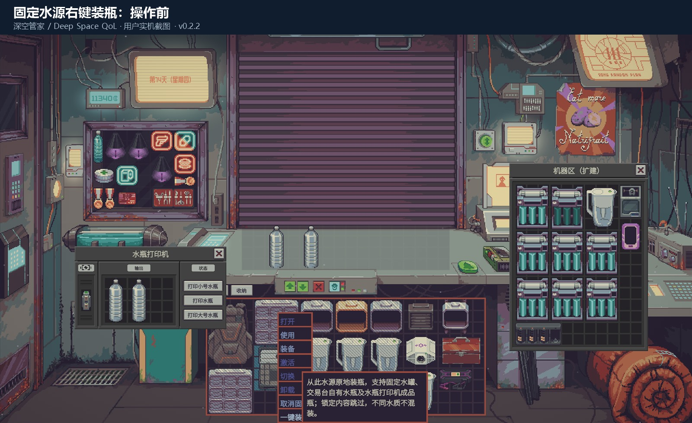
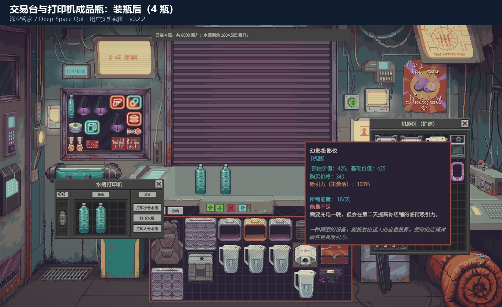

# 深空管家 / Deep Space QoL 0.2.2

修复上一版“一键装瓶”遗漏水瓶打印机成品瓶的问题：

- 识别游戏为打印机输出网格添加的单层原生界面包装。
- 扫描原生机器舱及扩展机器舱里安装的水瓶打印机。
- 不把机器舱散货、其他机器或打印机输入槽加入装瓶、收纳或上货范围。
- 保留锁定、所有权、原生交互否决、水质／组分／温度兼容及液体守恒校验。

## 安装

关闭游戏，解压 `DeepSpaceQoL-0.2.2.zip`，把 `deep_space_qol` 文件夹放到游戏安装目录的 `Mods` 中，再按原生模组菜单提示启用或重启。无需 BepInEx。

工坊订阅版更新同一条目，无需重新订阅。本地手动副本会遮蔽同 ID 的工坊版，转用工坊前请退出游戏并移出本地副本、保留备份。

## 验证范围

装瓶访问回归 101 项通过：先用接近原生包装的结构复现旧版失败，再验证两种机器舱中的三只打印机成品瓶均被发现且通过原生配对权限。离线测试不运行 Unity 场景或实际液体转移。

七套回归与原生模组扫描通过。上货、标签与整理实机截图来自用户的 0.2.1。**用户已在 0.2.2 实机复测确认：固定水源右键装瓶后，交易台两瓶和机器舱内打印机成品区两瓶均装上水，提示共装 4 瓶。** 完整存档往返与其他模组兼容性仍未全面验证，继续标记为测试版。

